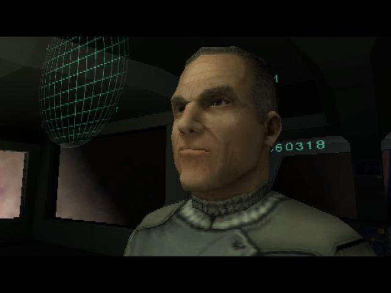
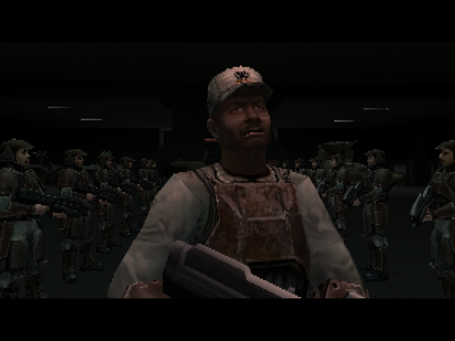
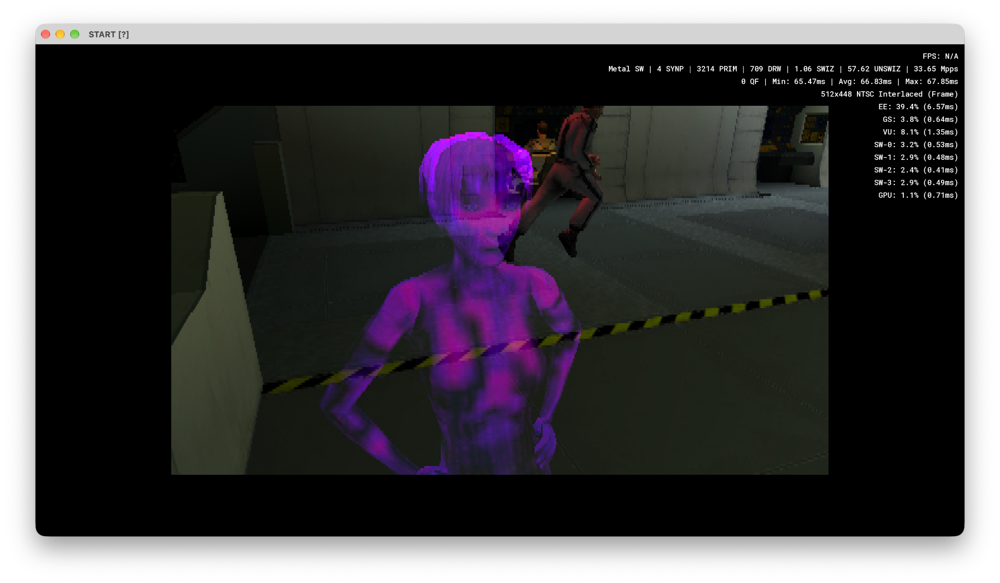
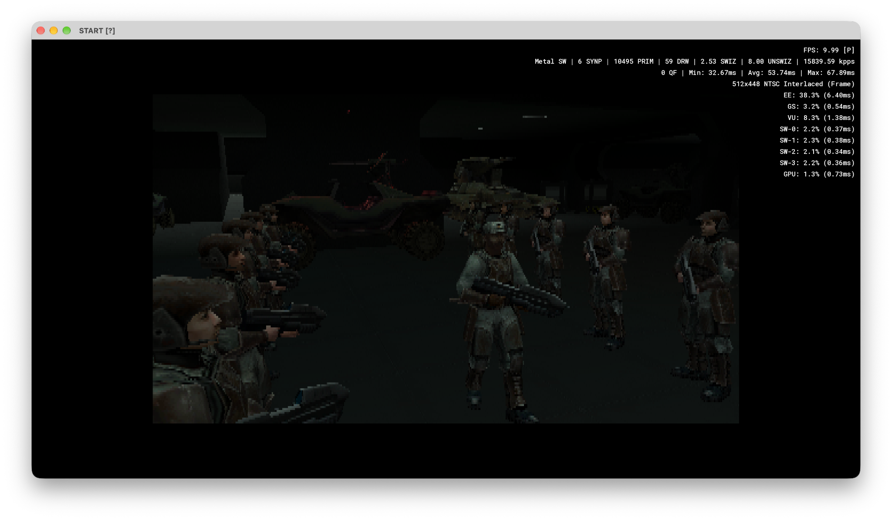
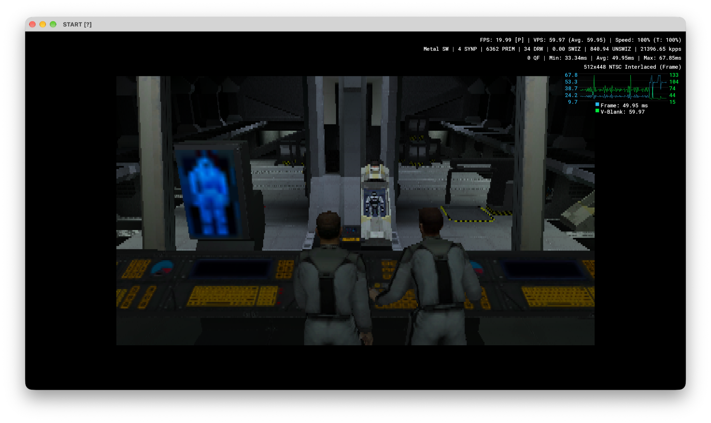
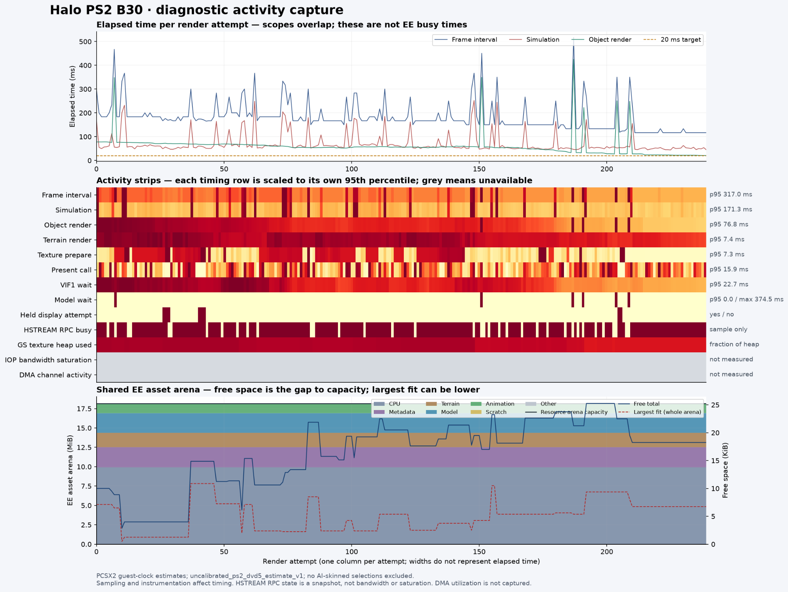
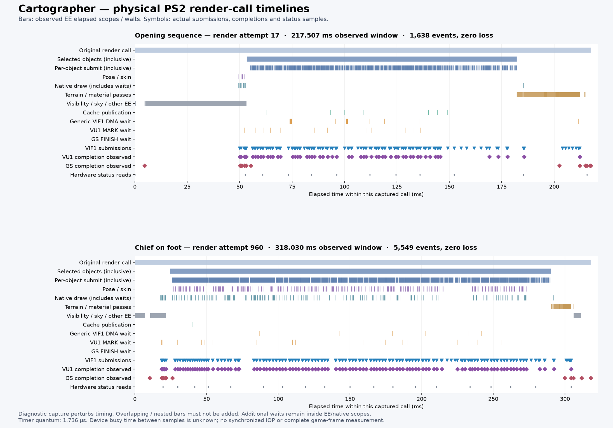

# The HALO PS2 Project

**Fidelity over compromise.**

The HALO PS2 Project aims to recreate the original Xbox Halo experience on PlayStation 2 as faithfully as possible—not merely to make the game run, but to preserve what makes it Halo. Through a highly optimised, purpose-built PS2 engine, the ambition is to deliver visual quality and gameplay fidelity beyond conventional expectations of the hardware, as though Halo had been developed for the console alongside its original Xbox release.

## Screenshots

**These screenshots are from earlier development builds and do not reflect the current state of the project. Updated screenshots will follow, with direct captures from real PlayStation 2 hardware planned once visual fidelity and performance have progressed sufficiently to showcase the experience we're aiming to deliver.**

### B30 - Pelican flyover

PCSX2 development capture, 12 November 2026.

### A10 - Per-pixel flashlight

PCSX2 development capture, 16 November 2026. Flashlight off (left) and on (right), showing the terrain diffuse-lighting test. The performance target remains unmet.

### B30 - Pelican landing

PCSX2 development capture, 12 November 2026.

  
  
  
  
  

### B30 — Early performance profiling

PCSX2 diagnostic activity capture from early B30 development, 12 November 2026. The chart records frame intervals, simulation and object-render activity, texture preparation, VIF1 waits, and shared EE asset-arena utilisation. Timing scopes overlap and should not be interpreted as additive EE busy time. This is an early profiling snapshot, **not a representation of current or final performance**.

  
  

## Project goals

- **Faithful gameplay:** retain the combat, encounters and interactions that make Halo feel like Halo.
- **Uncompromised animation and physics:** preserve the original animation and physics behaviour.
- **Original geometry:** retain model and terrain geometry without reducing their detail to meet the platform.
- **Original audio:** preserve the game’s music, dialogue, ambience and sound effects.
- **Faithful visual effects:** represent all original graphics effects as accurately as possible within the PS2 rendering architecture.
- **The complete game from physical DVD:** run the game from beginning to end on a real PS2, streaming from a physical DVD without requiring an internal hard drive.

These are the project’s targets, not claims that every system is already complete.

## Technical Development

Recreating Halo on the PlayStation 2 requires more than translating graphics calls. The engine is being designed around the console's distinctive strengths: its Emotion Engine, Vector Units, Graphics Synthesizer, limited memory and DVD drive. Each system has to preserve the original experience while making efficient use of that hardware.

### Native PS2 Rendering Engine

The renderer is built specifically for the PS2 rather than attempting to reproduce the Xbox graphics pipeline directly. Geometry preparation, transformation, clipping and drawing are distributed across the Emotion Engine, VU1 and GS, with an emphasis on keeping the vector units productive and avoiding unnecessary CPU work or data transfers.

The goal is to retain Halo's original environment and model geometry while making complex scenes practical on the PS2. This native rendering foundation is already operational in development builds, with performance optimisation continuing.

### GS Recipe System

Halo's Xbox shaders rely on capabilities that do not map directly to the PS2's fixed-function Graphics Synthesizer. The **GS Recipe System** approaches each shader or material as a sequence of carefully chosen GS rendering passes—a *recipe*—that reproduces its visual behaviour.

Recipes can combine texture sampling, blending, depth tests and framebuffer operations. Where a direct recreation would be impractical or too expensive, the system explores a cheaper PS2-native representation designed to preserve the same visual impression. Every recipe must satisfy both visual and performance requirements before acceptance.

### Texture Fidelity and Optimisation

The objective is to **preserve Halo's original full-resolution textures wherever practical**, rather than applying blanket reductions in resolution or colour depth.

Each texture is assessed individually for its most suitable PS2 conversion format, palette or colour-depth representation, reconstruction quality and actual resolution needs. **Root mean square error (RMSE)** provides a measurable indication of conversion error, alongside inspection of how the texture appears in the rendered scene.

This allows memory and streaming bandwidth to be saved where the visual impact is small, leaving more resources available for textures where the original detail matters most. The guiding principle is measured, per-texture optimisation to maximise fidelity to the Xbox image.

### lxGS — Advanced Lighting

**lxGS** explores how the PS2's GS and vector units can cooperate to produce lighting effects beyond conventional fixed-function expectations. The work includes per-pixel diffuse lighting, normal-map response, spotlights and flashlight illumination, with specular and material-dependent effects also under development.

Rather than treating every lighting feature as another full scene render, the architecture investigates buffer reuse, lower-resolution lighting data and efficient multipass operations. A per-pixel diffuse flashlight has been demonstrated; extending its visual response while meeting performance targets remains active work.

### aaGS — Antialiasing

**aaGS** is a family of PS2-oriented techniques intended to reduce jagged silhouettes, edge shimmer and crawling, particularly around the Halo menu's large, slowly moving ring.

The research combines subpixel sampling, selective edge treatment and GS blending operations, aiming to improve image stability without the cost of applying expensive processing across every pixel. The priority is a visibly smoother result at a sustainable frame cost, rather than antialiasing for its own sake.

An early experimental antialiasing solution has produced encouraging static comparisons. **The difference is much more pronounced in motion**, where the improvement in edge stability and reduced shimmering is harder to convey in screenshots. This remains experimental work, not a final integrated or performance-accepted solution.

### Visibility and Geometry Efficiency

Halo's environments can contain far more geometry than needs to be drawn from any one viewpoint. The engine retains useful BSP spatial information and combines it with visibility filtering, frustum testing and other culling stages to reduce work before geometry reaches VU1.

The objective is not to simplify Halo's original world, but to **avoid processing and drawing geometry that cannot contribute to the frame**. Work also focuses on efficient geometry batching, clipping and object processing so that the EE and vector units spend their time on visible results.

### Multi-layer Streaming and Prediction

A central engineering challenge is moving Halo's environments and assets through the PS2's limited memory without interrupting play. The engine is being developed around a **multi-layer streaming and prediction system**, rather than loading every resource for an entire level at once.

Its complementary layers coordinate:

- **Environment residency:** retain the active scene and prepare upcoming BSP or environment data as the player moves through connected spaces.
- **Predictive prefetch:** anticipate likely transitions from player movement and scene connectivity so required data can be requested before it becomes visible.
- **Independent asset streaming:** manage geometry, textures and other resources according to their priority, visibility and memory cost.
- **Memory-aware preparation:** schedule loading, decompression and residency changes around the available RAM and the demands of gameplay.
- **Frame-aware delivery:** coordinate streaming activity with rendering and simulation to minimise disruptive frame-time spikes.

The architecture combines working foundations with ongoing integration and tuning. Its long-term objective is seamless progression through the complete game from a physical DVD, without an internal hard drive.

### Virtual DVD System and Real Hardware Validation

Development and testing use **real PlayStation 2 hardware**, supported by a virtual DVD reading system that emulates disc seeks and read-data retrieval against a properly authored DVD ISO image.

Assets are positioned within that ISO with streaming performance in mind. This makes disc layout, seek behaviour and data access patterns part of the engineering process, rather than treating storage as an unlimited, instantaneous resource.

The virtual system helps test and refine loading behaviour under disc-like access conditions; final physical DVD performance still requires direct validation.

### Frame Director and Performance Engineering

The **Frame Director** is intended to coordinate simulation, rendering, effects and streaming as parts of a single frame workload, reducing dependence on separate manually controlled loops.

Performance work is guided by profiling on actual PS2 hardware as well as emulator diagnostics. CPU-side simulation, object handling, VU1 submission, rendering passes, memory transfers and streaming are investigated as a connected system. The target is a stable, responsive game—not an isolated benchmark or a visual effect that is too expensive to use.

## Project Status

**Active development.** Native PS2 execution, terrain and scenery rendering, first-person presentation, visibility processing, asset cooking and initial gameplay interactions have been demonstrated in development builds. Per-pixel flashlight lighting has also been shown, with further optimisation required.

Current work concentrates on renderer and simulation performance, shader and UI recreation, lighting, antialiasing, memory management and predictive streaming. These are evolving engineering systems; individual prototypes or successful tests do not imply that every feature is fully integrated or performance-ready.

**No release date has been announced.**

## How AI Is Used in This Project

The HALO PS2 Project is a **human-architected engineering project developed in collaboration with agentic AI tools**.

The project's overall technical vision, engineering direction and system architecture are conceived and overseen by its creator, who serves as **Project Lead and Systems Architect**.

The majority of the project's core architectural concepts originate from human-led research, technical reasoning and proposed solutions to the unique challenges of PlayStation 2 hardware.

AI acts as a collaborative engineering partner, helping investigate these concepts, assess their feasibility, explore alternative approaches and identify opportunities for refinement.

Through an iterative design process, proposed architectures are researched, challenged, tested and collaboratively refined before their final implementation is agreed upon.

### Roles and Responsibilities

**Project Lead & Systems Architect (Human)**

- Establishes the project's vision, technical objectives and engineering priorities.
- Conceives and proposes the overarching system architectures, rendering techniques and optimisation strategies.
- Defines hardware constraints, performance targets and expected behaviour.
- Directs technical investigations and evaluates proposed solutions.
- Oversees architectural development and makes final design and implementation decisions.

**AI Engineering & Development Agents**

- Research PS2 hardware capabilities and investigate the feasibility of proposed architectural concepts.
- Evaluate implementation strategies, identify limitations and suggest refinements.
- Collaborate in developing detailed technical specifications and implementation plans.
- Translate agreed architectures into working code, tools and engine components.
- Execute tests, analyse profiling data, diagnose problems and implement optimisations.
- Maintain technical documentation and development records.

### Development Philosophy

**Human architectural vision. Collaborative engineering. AI-accelerated implementation.**

The project follows a continuous cycle of architectural design, technical investigation, collaborative refinement, implementation and hardware validation.

AI is not used simply to generate code, nor is it responsible for independently determining the project's direction. Instead, it provides the research, analytical and implementation capabilities needed to explore and realise ambitious human-conceived engineering ideas.

All systems are subject to technical evaluation, performance measurement and testing, including execution on real PlayStation 2 hardware.

This approach combines **human creativity, architectural oversight and engineering judgement with the analytical and development capabilities of modern agentic AI**, enabling complex, hardware-specific systems to be developed and refined at a pace that would otherwise be difficult for a small independent project.

*And yes, this section was written by AI — with human input, refinement, and final validation.*

## About this repository

This is the public companion repository for The HALO PS2 Project. It contains the public README and project screenshots.

The development repository remains private. Source code, game assets, builds and confidential development documents are not published here.

## Contact

For questions about The HALO PS2 Project, contact [acidreach@gmail.com](mailto:acidreach@gmail.com).

## Acknowledgements

Halo and PlayStation are trademarks of their respective owners. This is an independent fan project, unaffiliated with Microsoft, Xbox, Bungie, Halo Studios or Sony Interactive Entertainment.
